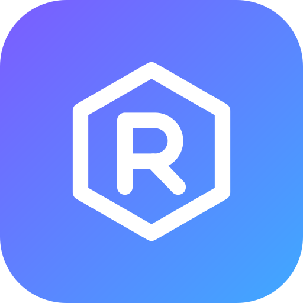

<div align="center">



# RumiStack

### ✨ Your AI development stack. One stable, simple, portable workspace.

**Discover · Organize · Configure · Launch · Sync**

A local-first command center for AI coding assistants, model gateways, web projects, skills, agents, MCP servers and developer tools — built to keep your development setup organized across Windows laptops.

<br>


[🚀 Quick Start](#-quick-start) · [🧰 Features](#-everything-in-one-workspace) · [📚 Documentation](docs/README.md) · [🛡️ Security](docs/SECURITY.md) · [🏁 v1.0.0 release](docs/RELEASE-1.0.0.md)

</div>

---

## 🌟 Meet your stable development workspace

### 🧭 New here? Start with the Setup Wizard

Open **Setup wizard** from the dashboard. Choose one coding assistant, optionally connect FreeLLMAPI or OmniRoute, review the suggested commands and save your setup. RumiStack never silently installs packages, starts services or stores API-key values. You can skip gateways, skills, agents and MCP entirely until you need them.

[📘 Follow the first-run quickstart](docs/QUICKSTART.md)


RumiStack brings your everyday developer setup into one calm, organized dashboard. Keep track of the tools you use, manage your AI providers, import repositories, launch web projects, organize reusable prompts and move your portable configuration between devices.

No cloud account is required to run the dashboard. Your tools continue running locally, under your control.

> **The idea:** one workspace for managing your development environment — without forcing every tool into one application.

## 🧰 Everything in one workspace

<table>
<tr>
<td width="50%" valign="top">

### 🤖 AI & developer tools
- 🔎 Curated tool catalogue
- ⭐ Favourite tools and quick launch
- 🧠 AI coding platforms: Claude Code, DeepSeek Harness, OpenCode, Codex CLI and more
- 🧩 Skills marketplace
- 🛠️ Reusable agent profiles
- ✍️ Prompt library with placeholders

</td>
<td width="50%" valign="top">

### 🔌 Models & integrations
- ⚡ FreeLLMAPI and OmniRoute profiles
- 🔐 Environment-variable based credentials
- 🧪 Provider connection checks
- 🔗 MCP server profiles
- 📋 Client configuration previews

</td>
</tr>
<tr>
<td width="50%" valign="top">

### 📁 Projects & repositories
- 🌐 Import GitHub repositories by URL
- 💻 Register existing local project folders
- 🗂️ Choose your destination drive and folder
- 🚀 Install dependencies and run Node.js scripts
- 📟 Per-project logs and local URL detection
- 🔄 Update and organize source repositories

</td>
<td width="50%" valign="top">

### ☁️ Sync & productivity
- 💻 Portable device profiles
- 📦 Export/import configuration bundles
- 🔁 Git-based sync and backups
- 🔖 Saved links and resource collections
- 🩺 Local health checks and activity journal
- ⌨️ Command palette and keyboard shortcuts

</td>
</tr>
</table>

## 💎 A closer look

### 🖥️ A focused dashboard
A refined interface with dark, light and automatic themes, configurable accent colours, comfortable or compact density, responsive navigation and a searchable command palette.

### 📂 Your projects, your folders
Import a GitHub repository into a destination you choose — for example, `D:\\WebProjects`, `E:\\ClientWork` or another drive. Existing folders can be registered in place without copying or moving their files.

### 🌐 Built for web development
Project Hub detects common Node.js frameworks and package managers, presents available scripts, and gives you explicit Install, Start, Stop and Logs controls. Importing a repository never runs its code.

### 🧩 Your AI setup, kept portable
Keep provider metadata, tool selections, skills, agents and MCP definitions in version-controlled profiles. Move your setup to another laptop without putting API keys or login sessions in Git.

## 🚀 Quick start

### Requirements
- 🪟 Windows 10 or Windows 11
- 🟢 Node.js 20 or later
- 🧬 Git for Windows
- 🐙 GitHub CLI is optional
- 🐳 Docker is not required for the standard RumiStack workflow

### 1. Clone RumiStack

```powershell
git clone https://github.com/rumitech-solutions/RumiStack.git D:\RumiStack
Set-Location D:\RumiStack
```

### 2. Set up and verify

```powershell
Set-ExecutionPolicy -Scope Process Bypass -Force
.\scripts\Setup-Workspace.ps1
npm run check
npm test
```

### 3. Launch your workspace

Double-click `Update-and-Start.bat` to safely update from GitHub, validate and start RumiStack. No `npm install` is needed for RumiStack itself.

For a manual launch, use:

```powershell
.\scripts\Start-Workspace.ps1
```

<div align="center">

### ✨ Your dashboard is ready

**http://127.0.0.1:47821**

Keep the PowerShell window open while using RumiStack. Press `Ctrl + C` to stop the local server.

</div>

> 💡 **No npm install required for RumiStack itself.** The dashboard and server use Node.js built-ins and a vanilla JavaScript frontend.

## 🗺️ How it works

```text
                     RUMISTACK WORKSPACE
                              │
          ┌───────────────────┼───────────────────┐
          │                   │                   │
     DISCOVER              ORGANIZE            CONFIGURE
          │                   │                   │
    Tool catalogue       GitHub repos        AI providers
    Skills & agents      Project Hub         MCP servers
    Saved resources      Local folders       Prompts & profiles
          │                   │                   │
          └───────────────────┼───────────────────┘
                              │
                         TAKE ACTION
                              │
                 Install · Start · Inspect · Sync
                              │
                     YOUR LOCAL MACHINE
```

## 🗃️ Workspace structure

By default, RumiStack lives at `D:\\RumiStack`.

```text
D:\RumiStack\
├── dashboard\       # ✨ Web interface
├── server\          # ⚙️ Local API and application logic
├── registry\        # 🧰 Curated tools and integration catalogue
├── config\          # 🔄 Portable profiles (no credential values)
├── docs\            # 📚 Guides and technical documentation
├── scripts\         # 🪟 Windows setup and maintenance scripts
├── templates\       # 🧩 Reusable assistant instructions
├── sources\         # 📦 Optional upstream repository clones
├── projects\        # 💻 Your workspace projects
├── logs\            # 📟 Local runtime logs
├── backups\         # 🛟 Local profile backups
└── state\           # 🧠 Local application state
```

**Choose another drive whenever you import a project.** Project Hub stores the imported files at the destination you select. Its registry and runtime state remain local to RumiStack.

## 🧭 Explore the dashboard

| Area | What it helps you do |
| --- | --- |
| 🏠 Overview | Review your environment health and setup progress |
| 🧰 Tool library | Discover AI coding platforms, gateways and developer utilities |
| 💻 Device sync | Define the tools and extensions you want on each laptop |
| 📦 Repositories | Import and update GitHub source repositories |
| 📁 Projects | Create, register, import and run projects |
| 🔖 Saved links | Organize useful sites, docs, APIs and resources |
| 🔄 Sync & backups | Review profile changes, commit config and restore backups |
| ✍️ Prompt library | Reuse prompts with fill-in variables |
| 🔐 Keys | Check whether referenced environment variables are configured |
| ⚡ AI providers | Connect FreeLLMAPI, OmniRoute and compatible model endpoints |
| 🧩 Skills marketplace | Browse and select reusable skills |
| 🛠️ Agent manager | Manage reusable agent instruction profiles |
| 🔌 MCP servers | Manage MCP metadata and generate client snippets |
| 📈 Activity | Review local workspace activity |
| ⚙️ Settings | Customize appearance, density, motion and bundles |

## 🔐 Privacy & safety by design

- 🔒 The dashboard binds to `127.0.0.1` only.
- 🧱 Mutating requests use same-origin protections and strict input validation.
- 🔑 Portable profiles store environment-variable names, not API key values.
- 🚫 RumiStack does not expose an arbitrary shell-command endpoint.
- 🧪 Importing a repository only downloads its files; it does not execute project code.
- ⚠️ Dependency installation and project scripts require separate user actions.
- 🛟 Git updates are fast-forward-only; dirty repositories are skipped.
- 📁 Projects, downloaded sources, logs, backups and runtime state remain local and are git-ignored.

**Important:** Only import and run repositories you trust. Dependency installation can execute package lifecycle scripts, and starting a project runs its selected script.

Read the full [Security Model](docs/SECURITY.md).

## ⚡ Model gateways without Docker

FreeLLMAPI and OmniRoute are treated as normal projects. Import their repositories through Projects (or register an existing folder), follow the upstream installation guide, start the service using its documented Windows method, then add its endpoint in AI providers. Docker is not part of this workflow.

See [Model Gateway Setup](docs/GATEWAYS.md).

## 🔄 Move your workspace to another laptop

1. Save your portable profiles in Dashboard → **Device sync**.
2. Review changes in **Sync & backups**.
3. Commit and push the tracked `config/` files.
4. Clone or pull RumiStack on your next Windows device.
5. Run the restore scripts with `-WhatIf` first, then approve the actions you want.

```powershell
.\scripts\Restore-Profile.ps1 -WhatIf
.\scripts\Restore-Skills.ps1 -WhatIf
.\scripts\Doctor.ps1
```

🔐 API keys, OAuth sessions, cookies, project code and local databases are not copied as part of portable profiles. Re-authenticate tools on each device.

See [Device Sync Guide](docs/DEVICE-SYNC.md).

## 📚 Documentation

New to RumiStack? Start with the [Documentation Hub](docs/README.md).

- 🧭 [First-run Quickstart](docs/QUICKSTART.md)
- 🚀 [Installation & Quick Start](docs/INSTALLATION.md)
- 🧭 [Architecture Overview](docs/ARCHITECTURE.md)
- 📁 [Project Hub](docs/PROJECT-HUB.md)
- ⚡ [Provider Manager](docs/PROVIDER-MANAGER.md)
- 🔌 [MCP Server Manager](docs/MCP-MANAGER.md)
- 🔄 [Device Sync](docs/DEVICE-SYNC.md)
- ⚡ [Model Gateway Setup](docs/GATEWAYS.md)
- 🛡️ [Security Model](docs/SECURITY.md)
- 🧰 [Maintenance & Updates](docs/MAINTENANCE.md)
- 📝 [Changelog](CHANGELOG.md)

## 🧪 Validation

Run these checks from the RumiStack folder:

```powershell
npm run check
npm test
npm run verify-registry
```

The automated checks do not replace testing on your actual Windows machine. PowerShell scripts, third-party provider connectivity and project-specific package scripts should be validated on the target device before relying on them.

## 🛣️ Product direction

RumiStack is designed to grow as a modular local developer workspace. The current focus is reliable project organization, AI tooling management, safe integrations, portable configuration and a polished everyday workflow.

Feature support depends on the upstream tool and runtime. RumiStack does not claim that every language, framework, package manager or container workflow can be launched automatically.

## 🏢 Built by RumiTech Solutions

**Building Ideas Into Digital Products.**

RumiStack is part of the RumiTech Solutions product ecosystem.

<div align="center">

**✨ One workspace. Your tools. Your projects. Your control.**

[⬆ Back to top](#rumistack)

</div>
